# Getting Started on the Canvas

The canvas lays your whole card out on one big board. Openings, lore, variables and behaviors are all right in front of you: click something, change it. This page starts from a blank card and makes a small playable one, a little tavern run by Yumina, a talking mushroom.

The canvas is still in **Beta**. If you run into problems, tell us on Discord

## 1. Make a new card

Click **Create** on the left and choose a template or **Blank Project**. The card opens straight on the canvas.

If you'd rather fill in a one-page form, the ⋮ menu at the top right has **Simple mode**: fill it in from top to bottom and you can play. It's handy when you just want a quick character card.

Cards you already have open on the canvas too. Look at the top left: next to the back arrow is a small switch labelled **Canvas**. Turn it off to go to the full editor, and every card you open goes there until you turn it back on. It's the same card either way, and nothing gets lost.

## 2. Take a look at the board

A freshly made card looks like this:

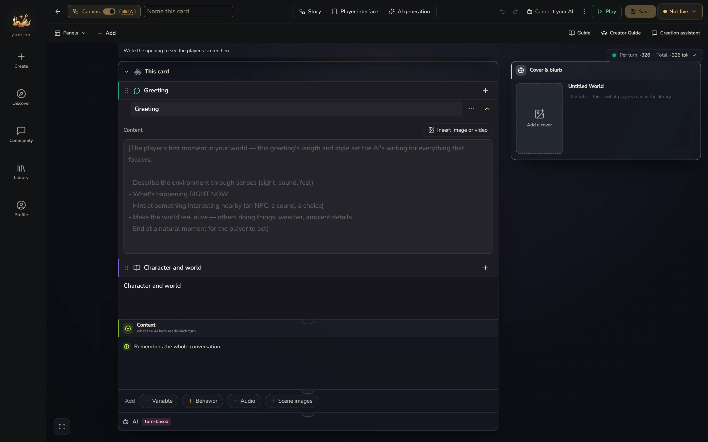

The big frame in the middle is **This card**. Right now it holds just two things: the opening (**Greeting**) and **Character and world**. The **Add** row near the bottom is where variables, behaviors, music and scene images come from. You'll use it in a minute. Skip **Context** above it and **AI** at the very bottom for now. We'll get to them later.

The strip above the frame is the **Player interface**. Once you've written an opening, it shows what the player will see. For a different look, press **Switch interface** on it: a column of interfaces opens on the right, a click puts one on here at once, **Use this** keeps it and **Undo** puts back what you had. On the right is **Cover & blurb**, the first thing players see on Discover. We'll do that last.

Drag empty space to move around, Ctrl + scroll (⌘ on a Mac) to zoom, and **Fit everything** in the bottom left if you get lost.

## 3. Write the opening

The opening is the first thing a player reads when they open your card. Click the big box under the opening and start typing:

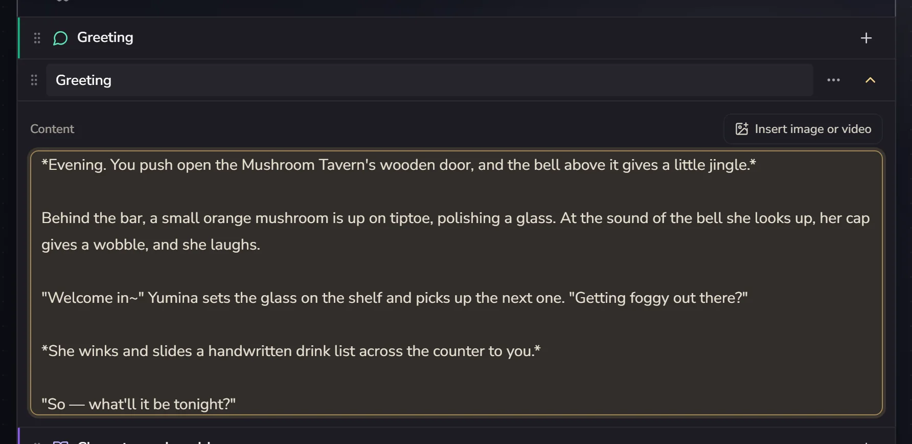

The AI follows the length and style of your opening, so end it with a little hook that tells the player what to say next. For tips on writing a better one, see [Openings and lore](/creator/entries#openings).

## 4. Write the character and world

This part is for the AI: who it plays, what the world looks like, what the rules are. Click the row under **Character and world** and it opens up. Fill in a name and the content:

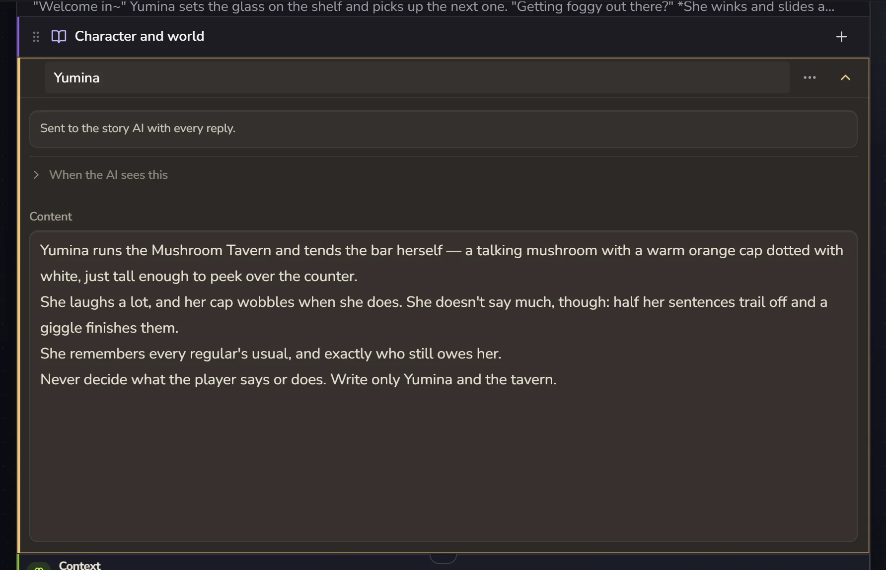

One entry per character, one per place. Kept separate, they're harder for the AI to mix up. To add another, click the **＋** in the top right of this block.

Lore can also do things like "only go to the AI when a certain word comes up". When your card gets bigger, read [Openings and lore](/creator/entries#lore).

## 5. A few ways to change things

**Click once** selects a row, **click again** opens it in place, and **double-click** opens the full-page editor, which is nicer for long text. **Ctrl + click** selects several rows at once.

One trick worth knowing: drag a row out onto empty canvas and it is "taken out". It fades, gets a **Not in play** tag, and is not sent to the AI until you drag it back. Use it to switch something off for a while without deleting it.

## 6. Add a variable

Variables are things the story needs to remember, like affection or coins. In the **Add** row near the bottom of the card, click **＋ Variable**:

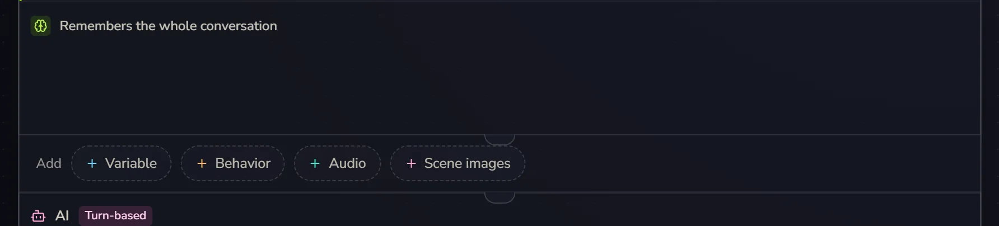

A **Variables** block appears in the card, holding a **New variable** with its settings already open:

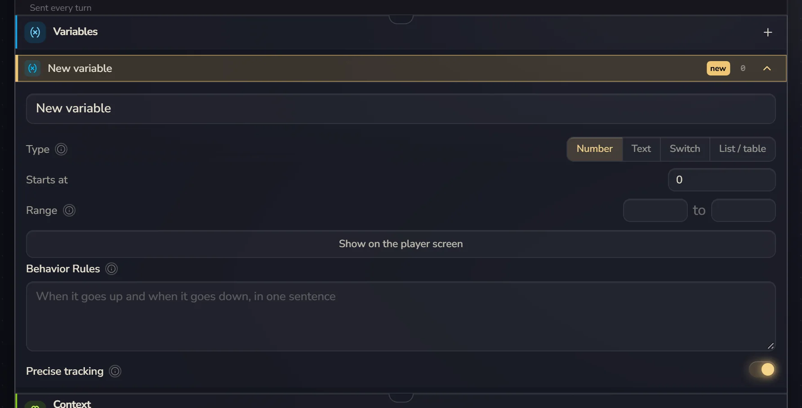

Give it a name, say where it starts and its lowest and highest values, then use **Behavior Rules** to say in a sentence or two when it goes up and when it goes down:

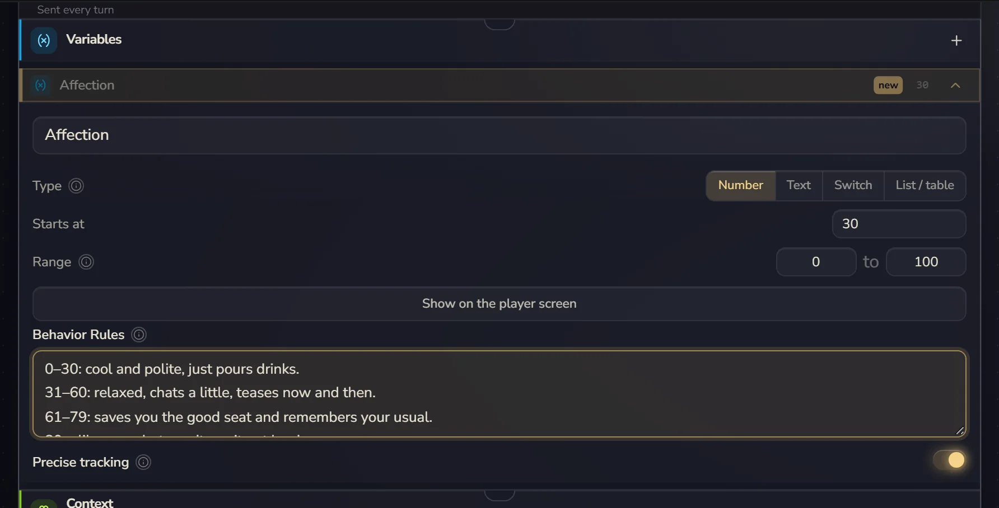

Use the variable’s **Show on the player screen** switch to add its display. Switch it off to remove the display; the variable and its value stay in the card. Canvas previews keep setup changes temporary. If a custom setup needs AI, it can use its own fallback in the preview; use Playtest for real AI responses.

No need to write formats like `[Affection: +5]`. The engine teaches the AI that by itself. For how to write Behavior Rules and what Precise tracking is, see [Variables](/creator/variables).

## 7. Add a behavior

A behavior is "If this, then that." The engine runs it by itself, so it's reliable. Back in the **Add** row, click **＋ Behavior**:

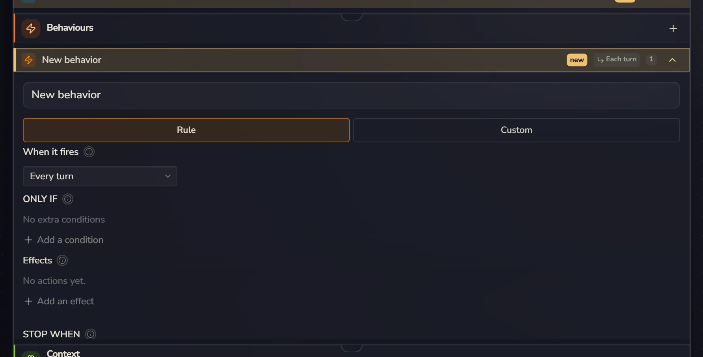

Every behavior has three parts: **When it fires**, **ONLY IF** (optional) and **Effects**. Let's make one: when affection rises above 80, show the player a note.

Switch **When it fires** to **Variable crosses threshold**, then pick Affection, Rises above, 80. Next click **Add an effect**. Effects come in a few groups. Pick **Show notification**:

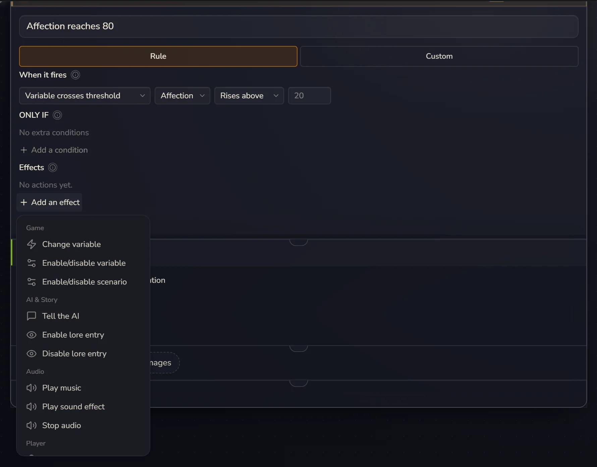

Type in your message and you're done. The dashed line that appeared between Affection and this behavior means the behavior is watching that variable.

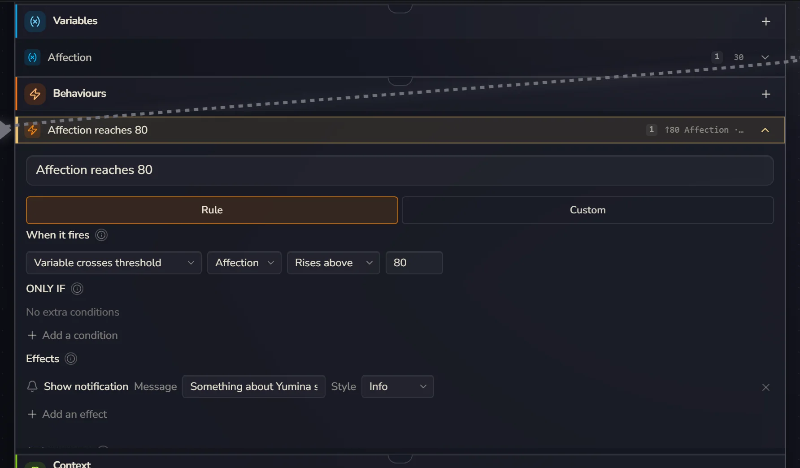

Behaviors can also change values, open lore, play music, hand the player a picture card, and be called from buttons. All of that is in [Behaviors](/creator/automation).

## 8. Give it a try

At this point your card is playable. Click **Play** on the right of the top bar:

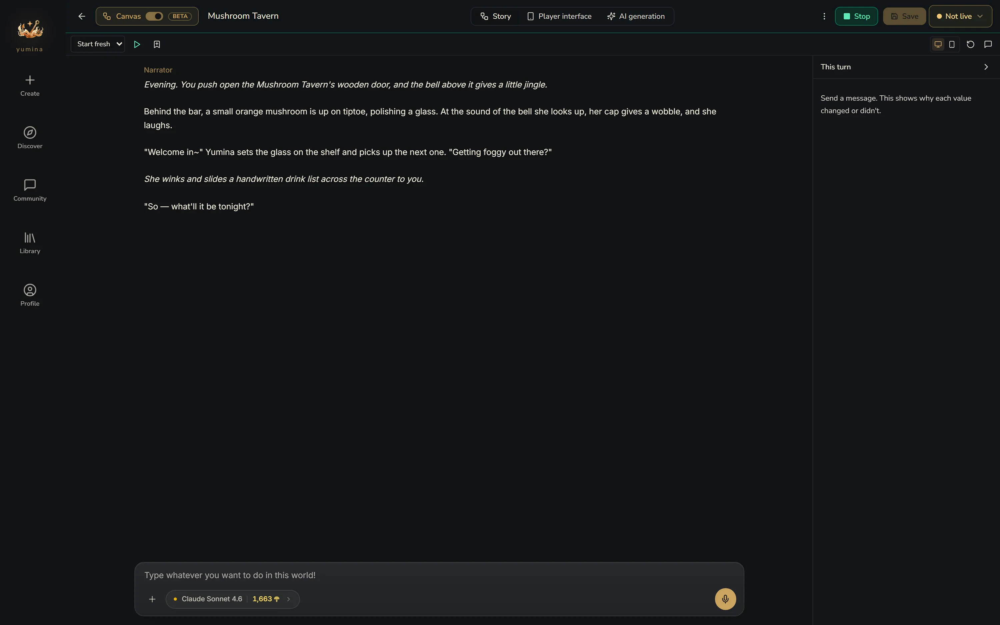

A playtest really starts a game with the model you picked, so it **uses up credits**. **This turn** on the right shows what happened behind every turn: what the AI got, why a number changed, why a behavior didn't run. How to read it is in [Playtest](/creator/playtest).

When you've played enough, click **Stop** to go back to the canvas and keep editing.

## 9. Name it and add a cover

Click **Add a cover** in **Cover & blurb** on the right:

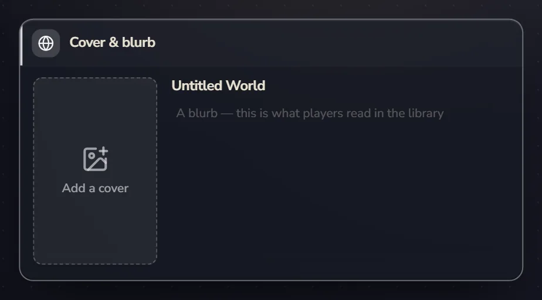

**Card settings** opens on the right. At the top is **Card title**, and below it **Cover Image**:

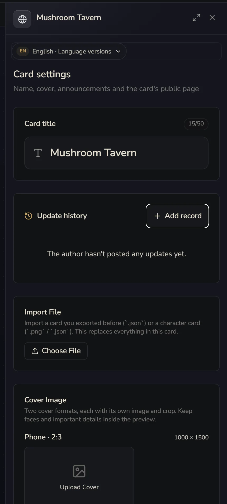

Upload portrait artwork for 2:3 cards and wide artwork for gallery views, or reuse the portrait. In Gallery display, adjust Desktop banner (21:9) and Mobile and gallery cards (16:9) separately. Save crop keeps both selections.

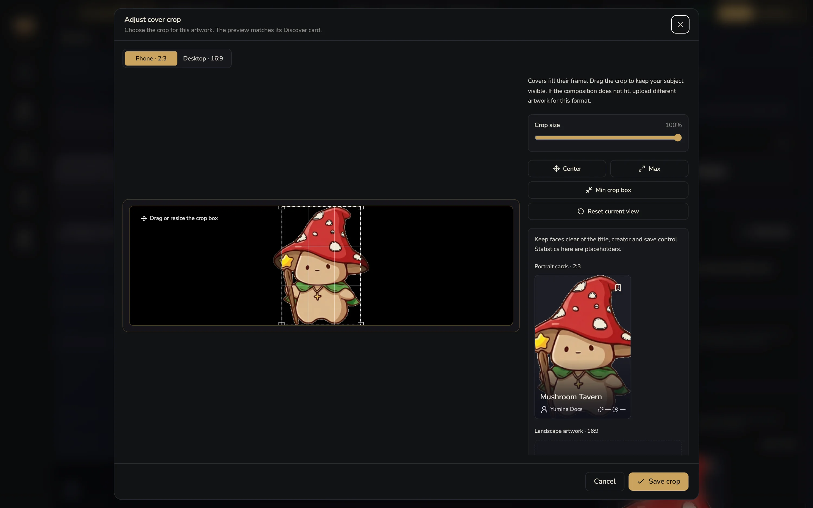

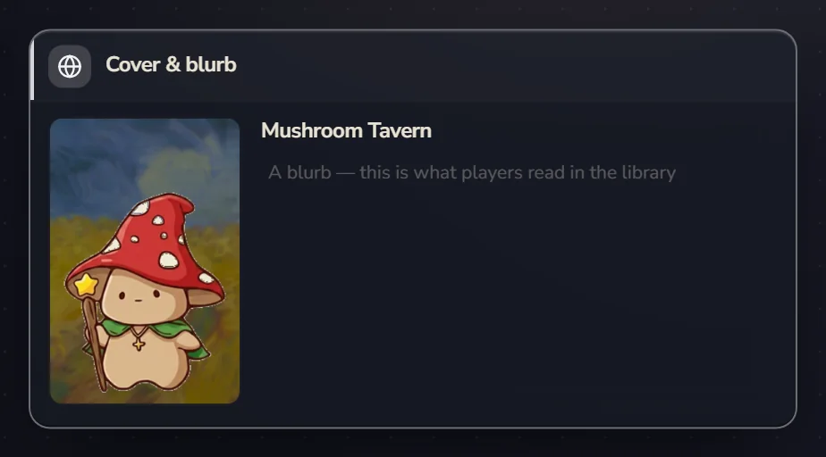

Card settings also has the blurb, language, gallery, and card-wide switches like Smart tracking and Sound. Come back to those when you need them.

## 10. The top bar

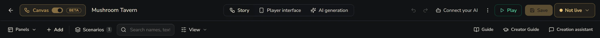

The three buttons in the middle are three ways of looking at your card. **Story** is this canvas. **Player interface** is the screen the player sees, covered in [Player interface](/creator/player-view). **AI generation** makes pictures, covered in [Visuals & audio](/creator/visuals-audio#ai-image-generation). On the right, **Connect your AI** lets your own Claude, ChatGPT or Cursor edit the card, the ⋮ menu holds Change History, import and export, and simple mode, and **Not live** is where you publish.

**Panels** on the second row holds Card settings, Interface code, Assets, Languages & variants and Version History, plus **Full-page lists**, which show your openings, lore, variables and behaviors as tables on one page. Much faster when you have lots to change. **Add** holds the three things you want once a card gets big: a scenario, an AI call and a sticky note. Everything else is added where it lives, with the ＋ on its own block.

The **Creation assistant** is the built-in AI. New conversations start in Plan: tell it what you want, settle the scope, then choose **Start building**. See [The Creation assistant and your own AI](/creator/studio-ai). **Guide** is Yumina, the little mushroom, walking you through it lesson by lesson on your own card.

## 11. When your card gets bigger

**Sticky notes.** Right-click any row and pick **Sticky note**, or use **Add → A sticky note**, to leave yourself a reminder like "Make the price change with the time of day?". Select several things first and the note sticks to all of them. Notes are never sent to the AI that runs the game, but the Creation assistant reads them and knows where each one is stuck, so you can jot every idea down as a note and then say "go through the sticky notes and make the changes".

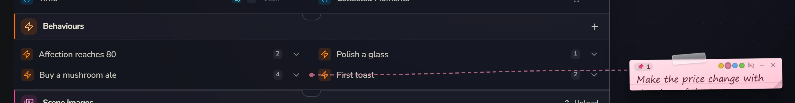

**Relationship lines.** The lines show what is connected to what: which variable a behavior watches, which lore waits for a variable. Hover a row and its lines light up. Some you can drag out yourself. Drag a variable onto a piece of lore and you get "only send this lore when the variable meets a condition", then click the line to change the condition. With several rows selected, a floating bar offers **Move to…** a scenario, **Share with every scenario** and **Delete**.

## 12. Save and publish

Your changes save as a draft automatically, about once a minute. To save right away, click **Save** (Ctrl+S). Saving doesn't make your card public. Nobody else can see it yet.

When you're ready to go live, click **Not live** in the top right. It runs through a short checklist: a name, a cover, an opening, and at least one playtest. Once everything is ticked, you can click **Publish**:

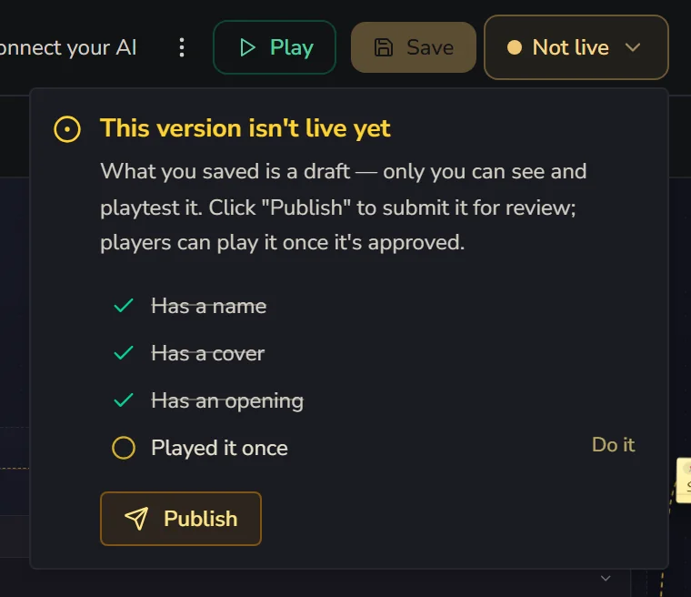

Publishing goes through review. Once it passes, players can find your card on Discover. For content ratings, tags and updating after you publish, see [Publishing](/creator/publishing).

## All done

If you followed along, your card looks something like this:

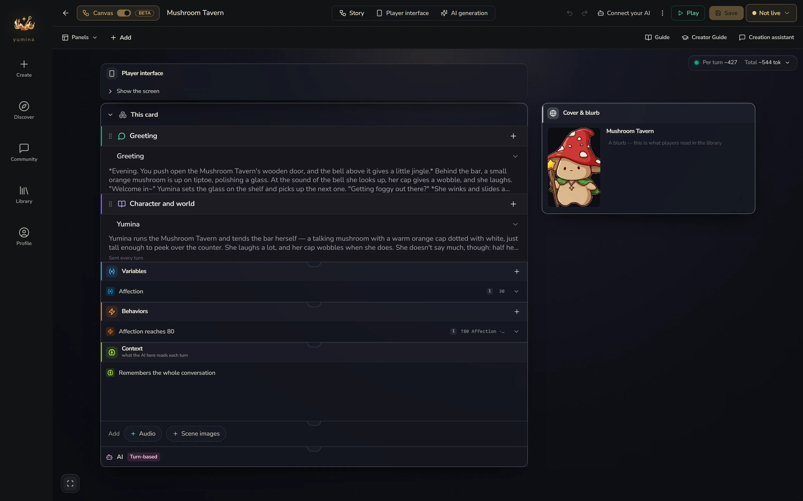

Later on you can add scenarios, a few more AIs and a player interface, and a card might grow into something like this:

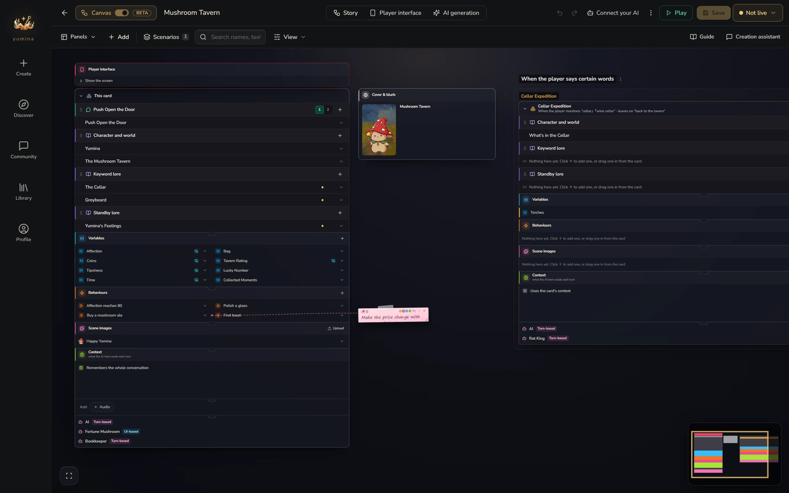

## On a phone

A phone screen can't fit the whole canvas, so phones get their own Studio. Drag empty space to pan, pinch to zoom, tap a block to edit it, then go Back to the board. The switch in the top left is called **Studio** on a phone. Turn it on and the bar along the bottom reads **Assistant**, **Opening**, **Lore**, **Playtest** and **More**. The Creation assistant comes first and is what you see when you open it, because on a phone, typing "add some coins for me" to the assistant is often quicker than tapping around yourself.

You can edit openings, lore, variables and behaviors on a phone, and playtest too. Adding or editing AIs and dragging things into scenarios still needs the canvas on a computer.
