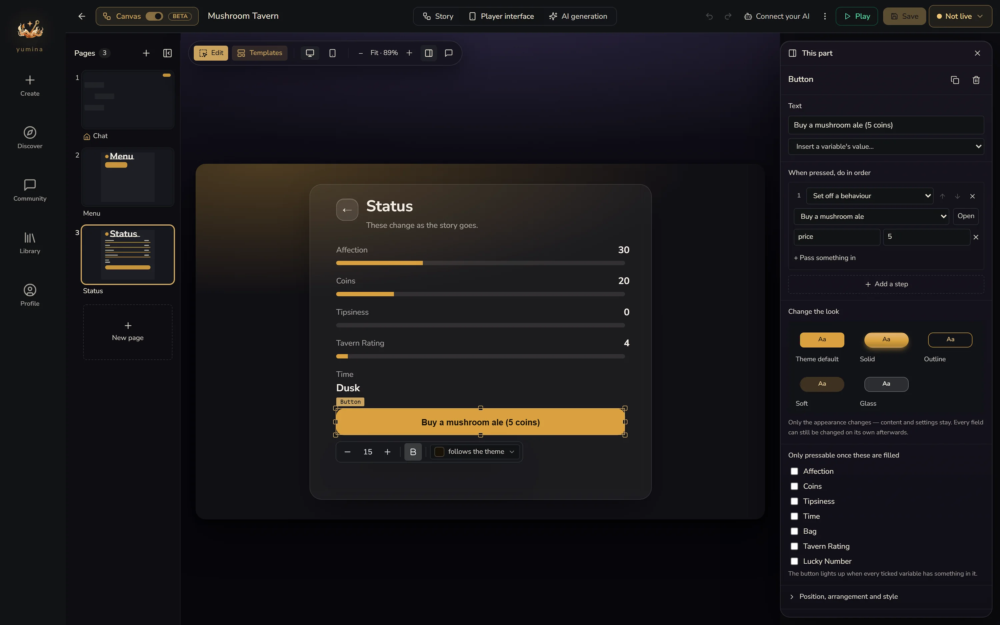
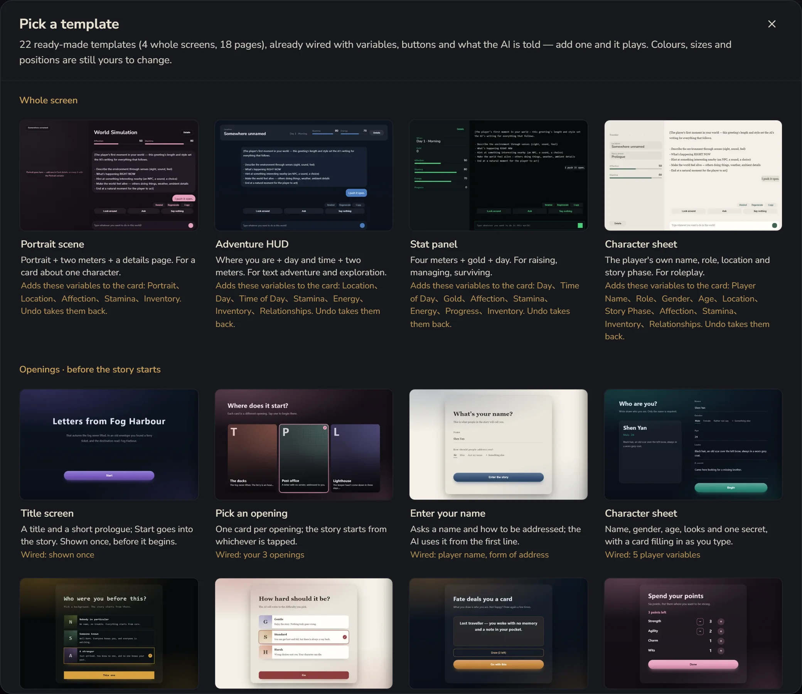
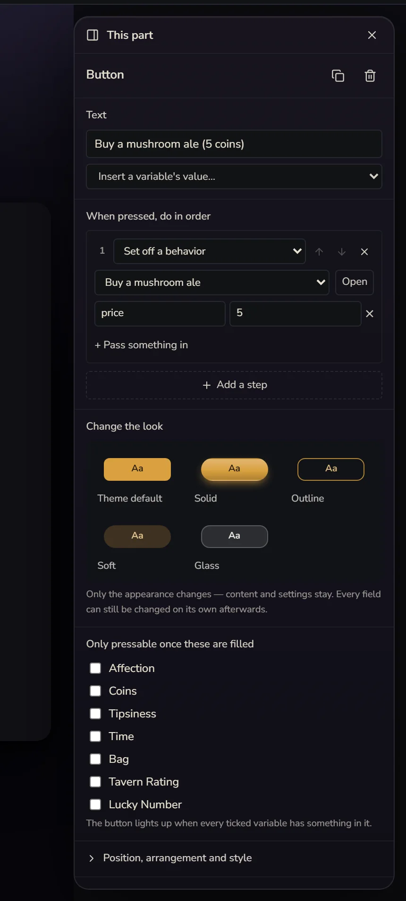

# Player Interface

The player interface is the screen players actually see while they play. If you leave it alone, it's the default chat interface. If you want to give your card an opening page, a status panel, an inventory or a map, this is where you build them, **no code needed**.

There are two ways in: click **Player interface** in the middle of the top bar, or on the canvas, double-click the player interface preview stuck on top of "This card" (the pencil in its top right works too).

## Start from a template

Click **Templates** at the top to open **Pick a template**.

There are 22 ready-made templates, already wired up with variables, buttons and instructions for the AI. Add one and it plays.

**Whole screen**: swaps out the look of the whole card in one go. There are twelve, and these four cover most cards

| Template | Good for |
|---|---|
| Portrait scene | A card about one character: portrait, two meters, a details page |
| Adventure HUD | Text adventure and exploration: current location, day and time, two meters |
| Stat panel | Raising, managing, surviving: four meters, gold, day |
| Character sheet | Roleplay: the player's own name, role, location and story phase |

Every whole-screen template tells you "Adds these variables to the card". Stat panel, for example, adds Day, Time of Day, Gold, Affection, Stamina… These are ordinary variables. Back on the canvas you can see them, change them, and drive them with behaviors. If you don't want them, undo.

**Openings · before the story starts**: Title screen, Pick an opening, Enter your name, Character sheet, Pick a background, Pick a difficulty, Draw an opening, Spend attribute points, Confirm before starting. The player goes through these in order before the story begins, and what they pick is handed to the AI. Fill in a name, for instance, and the AI calls you by it from the very first line.

**While playing · opened from the chat page's Menu**: Status page, Inventory, Map, Phone messages, Relationships, Daily actions, Dice check, Clues and accusation, Collection.

There's also a **Blank page** with nothing on it, for laying things out yourself.

On the canvas, the **＋** on **Player interface** (**Add a page**) opens this same template library.

## Pages

The column on the left holds every page in the card, like slides. **New page** picks from the same templates. A page with no button leading away from it gets a **No way out** warning, so players never get stuck.

## Edit right on the screen

While **Edit** at the top is on, click a part to select it, drag it to move it, and pull a corner to resize it. Turn **Edit** off to press buttons like a player would. This is a preview: it does not call the AI and costs nothing.

**Desktop** and **Phone** switch the preview width. Each width keeps its own positions and sizes, and you are editing whichever one you are looking at, so check both before you finish. Some parts can be set to show on one of them only.

Select a part and its settings open on the right. Text can **Insert a variable's value…**, like "Day {current day}". **Add a part** offers Text, Button, Image, Panel, Meter, List, Card picker, Form field and Popup. **Layers** lists every part on the page, which is the easiest way to find something hidden behind something else.

### How the conversation looks

You can't delete the **Conversation** block in the middle or the input box below it, but you can change how they look. Select it, and **Message look** offers Platform, Bubbles, Novel, Letter and Terminal. Further down, **Fine-tune text, bubbles and special formats** lets you change the font and bubble colours separately, and even style special formats (like *italic* action lines).

## What buttons can do

Select a button, and under **When pressed, do in order** you can line up several steps:

- **Say a line for the player**: like "Look around". One click and it's as if the player said it
- **Change a variable**
- **Set off a behavior**: you can **+ Pass something in**, see [Behaviors · Passing a value from a button](/creator/automation#passing-a-value-from-a-button)
- **Call an AI**: calls a UI-based [AI](/creator/ais), like a fortune teller
- **Switch opening**, **Go to page**, **Pick at random**
- **Show a notice**, **Play audio**, **Stop audio**
- **Regenerate**, **Undo last turn**

**Only pressable once these are filled**: tick a few variables, and the button only lights up once they all have something in them. The "Start" button on an opening page often uses this, so nobody gets in without a name.

**Change the look**: Theme default, Solid, Outline, Soft, Glass. Only the appearance changes, not the content.

## Writing your own interface code

When templates and parts aren't enough, you can build it all yourself. Interface code lives in **Panels → Interface code**. Write it by hand, or have the Creation assistant write and edit it for you. Details in the [Custom UI guide](/creator/advanced/custom-ui-deep).

## Write for me and Note to the AI

The default chat's input box gives players two tools:

- **Write for me** (in the + menu): with the box empty, the AI writes the player's next move; with text in it, it expands that line into a fuller message. It writes only the player's own character, never other characters, and never moves the plot on. The result only fills the box, so the player edits and sends it. It runs on the player's chosen model and costs one call.
- **Note to the AI** (in the + menu): a direction for the next reply only, like "slow down, let her speak first". It is not story text and never goes into the recap or memory. A small line on the player's message shows it.

For cards where the player's own wording is the game (riddles, passwords), click the card on the canvas and turn **Write for me** off under **Player input**. In your own interface code, use `api.composeAssist()` and `api.sendMessage(text, attachments, { note })`; see the [API reference](/creator/advanced/08-api-reference).

## Common questions

**How do I change the theme (colours, fonts)?** Each layout in **Switch interface** comes with its own colours. To change them, click **Edit** on the Player interface block, select a part, and set its colour, font and corners. You can also tell the Creation assistant, for example "make the accent dark red and use a serif font".

**Where is the code?** Click **Code** on the Player interface block (it shows when the card has interface code), or open **Panels → Interface code**. Typing "code" or "theme" in the canvas search box also takes you there.

**Can I save my own setup as a template?** Yes. Open **⋮ → Save as template or pack**, choose **Template**, tick what to include and save it to your library. Use it again from **Resource market → My Library**, on this card or a new one.

**Can I add a leaderboard?** Yes. Tell the Studio assistant "add a leaderboard" and it draws one in the card's current style, showing the player's rank when a run ends. Change its look however you like. See [Leaderboards](./advanced/recipes/leaderboard.md).

## When you're done

Once saved, this is the interface both playtests and players see. When you're done, click **←** in the top left to go back to the canvas.
