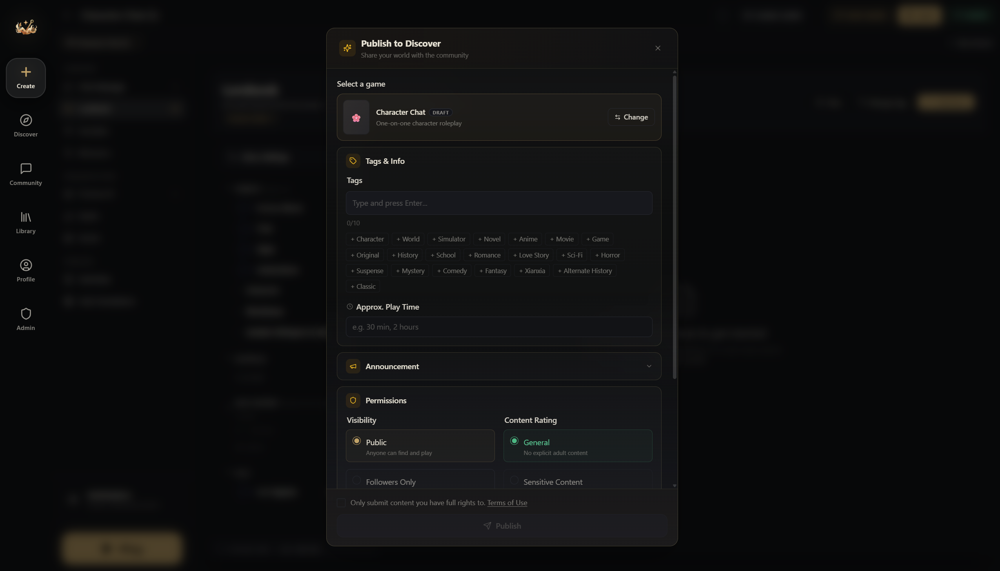

# Publishing

Public cards appear on Discover. Anyone with the link can play a link-only card after review. Followers Only limits play to people who follow you.

> Cover and asset rules: effective October 24, 2026 at 11:59 p.m. Pacific time. [See the notice and previous rules](/legal/community-guidelines).

## Anyone with Link

Choose **Anyone with Link** in Publish settings to invite testers after review. Anyone who receives the link can play and forward it. This is not a named-person invite list. Link-only cards stay out of Discover, search, and profiles.

After approval, open the notification to open Share, then press **Copy link**. Share is also available on the card preview on desktop and mobile.

To send the card in a DM, choose **Share World** → **My works** and select the version you want to send. A recipient of a followers-only card must follow you to play.

To make the approved card discoverable later, change its visibility to **Public** and save. The approved version becomes public; edits awaiting review remain held.

## Content rules

- **Limited = every asset is safe for work and non-suggestive**, including in-game art, audio, custom UI, and linked media.
- **Limitless covers and public previews must be non-explicit:** no nudity, sexual acts, or graphic gore. Keep intimate areas covered with opaque clothing.
- **Check all public material:** cover, gallery, screenshots, title, description, tags, and every language version. Shared profile images must meet Limited standards.
- **Blur does not make an explicit image acceptable.** Mark a suggestive Limitless cover **Blurred**, but make sure it passes the rules when fully visible.
- **Use assets you have rights to publish** and follow the [full cover, asset, and content rules](/legal/community-guidelines#publishing-media). Review again after updates.

## Before you publish

- **Playtest.** Send 10 to 20 messages. Check that variables update, lore is sent when it should be, and how it plays.
- **Write the blurb.** It is the first thing players see on Discover, so say clearly what the card is about.
- **Add both covers.** A tall one for phones and a wide one for desktop. Both are required.

Upload portrait artwork for 2:3 cards and wide artwork for gallery views, or reuse the portrait. In Gallery display, adjust Desktop banner (21:9) and Mobile and gallery cards (16:9) separately. Save crop keeps both selections.

- **Pick the content mode.** Limited for regular content, Limitless for adult content. Mislabelling breaks the community guidelines.
- **Add tags.** Players find your card through them. Up to 50.

## How to publish

1. On the canvas, click **Cover & blurb** on the right. Fill in the name, the blurb, the language, and both covers.
2. Click **Not live** on the right of the top bar. Studio checks four things first: a name, a cover, an opening, and at least one playtest.
3. The publish dialog sets tags, play time, content mode, visibility (Public, Anyone with Link, or Followers only) and target audience. Three switches are easy to skip past and matter:
   - **Derivative works.** Others can make an editable copy of your card. On by default. Turn it off to keep your work yours.
   - **Custom API keys.** Players may play your card with their own key. On by default.
   - **Lore Shift.** Players with the Lore Shift extension can change the lore and values you allow, in their own game only. Off by default. Turn on **Allow session editing**, then tick **Players may edit this** on the entries and variables you want to open up. **Allow new session lore** lets them add their own lore, ranked below yours.
4. Tick the terms and click **Publish**. An AI reviews first, then a person when needed. You can submit up to 100 times an hour.

Your card's public address is `yumina.io/@yourname/card-name-id`. Old links keep working after a rename.

## Updating a live card

Keep editing after you publish. Changes to lore, the interface, the content mode or the cover wait for review while players keep seeing the live version. Small listing changes go live at once. Submit the update from the publish menu, with an optional note, and choose whether to notify players who have played your card. Players mid-game keep the version they started with. New games get the update.

## Versions

While you edit, a version is saved every 15 minutes. **Panels → Version History** keeps the latest 20 automatic records, thinning older ones to one a day for 30 days, plus 10 versions you name yourself. **Restore to draft** brings any version back into the editor, after a safety snapshot of your current draft, and you publish it through review as usual. **Make live** swaps the live card to a version that was live before. Neither touches listing details like the title and tags.

## Language versions

One card can have a version per language. Open **Panels → Languages & variants**, or the bar at the top of **Cover & blurb**, and make a new version. It is a separate copy where lore, openings and variables are written again in that language, or translated in one go by the Creation assistant for mushies. Versions are linked in a language group and published separately. The ★ **Main** one is what people see when browsing, and players can switch to the others after opening the card.

**Translate with AI** (in the language menu next to the card's name in the Studio top bar, or ask the Studio assistant) makes an English, Chinese, Spanish, Korean, Indonesian or Russian version for you. It translates the opening, lore, variable rules, keywords and the interface's labels, and keeps variable ids, directives and the values the interface checks unchanged. It shows the price first (up to a set number of mushies; you pay what it actually cost, and nothing if it fails), runs for a few minutes in the background and leaves a **draft**: open it, check the spots it lists, then publish it like any version.

## Taking a card down

**Unpublish** in the publish menu takes down this version, all versions, or the ones you choose. Players with saves see "No longer available" until you publish again, which goes through review once more.

## Gallery and announcements

Add up to 8 gallery images to the card's page. Every one is a public preview and follows the cover rules, even a screenshot from Limitless play. Pin an announcement of up to 2,000 characters for update notes or known issues.

## Related

- [Playtest](./playtest.md)
- [Earnings and payouts](./earnings.md)
