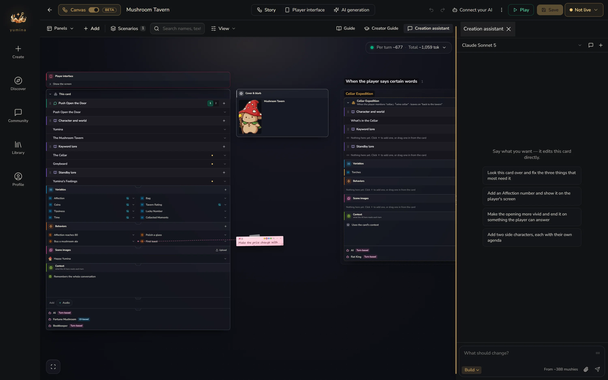

# The Creation Assistant and Your Own AI

The canvas has a built-in **Creation assistant**, and you can also hook up the Claude, ChatGPT or Cursor you already use to edit your card.

## The Creation assistant

Click **Creation assistant** in the top right of the canvas and its chat opens on the right. Tell it what you want in everyday words:

> "Add a sly merchant called Vex who talks in riddles and has trust issues"

> "Make a hunger system that drops over time. When it hits zero, the player dies"

> "Build a dark fantasy interface with health, mana and inventory slots"

> "Combat's too easy. Make enemies hit harder and add a wound system"

It can write lore and openings, add variables and behaviors, open scenarios, add AIs, build the player interface, check where things are wired wrong, and search the whole card. Its changes show up live on the canvas.

### Two modes

New conversations start in **Plan**. Once the scope is clear, the assistant offers a build confirmation with a summary and concrete steps. **Start building** switches modes and executes the exact plan you reviewed. **Keep brainstorming** leaves the card unchanged; the same plan will not pop up repeatedly. Use **Review build plan** to reopen it.

You can also switch under the input box:

- **Plan**: for when you haven't decided what to make yet. It chats with you and helps shape your ideas into a **creative brief**, without touching the card
- **Build**: gets to work on the card, using the creative brief you confirmed

### Changing only certain parts

First select the parts you want changed on the canvas (Ctrl + click to pick several), then talk to the assistant, and it focuses on just those. What you selected shows up as little tags above the input box.

Each part also has **Write this one for me**. One click asks the assistant to write just that part.

### Sticky notes

The assistant reads every [sticky note](/creator/canvas) on the canvas and knows what each one is stuck to. If you have too many ideas to explain at once, stick them on as notes first, then tell it "go through the sticky notes and do all of these".

### Looking things up online

For fan cards and cards based on an existing work, the assistant looks up the canon facts it is unsure of (names, ages, relationships, abilities, the order of events) on fan wikis, Fandom and Wikipedia, and links its sources in the reply. You can also paste an address for it to read. It does not search for things you are inventing.

- Each search costs about 8 mushies from your balance (also when you use your own API key, since the search runs on Yumina); reading a page is free
- At most 12 searches and 24 pages per request
- Some sites refuse to show pages to servers; the assistant then uses the search excerpt or another source
- To keep it offline: open **Plan / Build** under the input box and untick **Web search** (remembered in this browser)
- When the card has the original book attached, the book wins; the web only fills gaps

### If it breaks something

After each round of changes, a little strip called **The assistant's last turn** appears at the bottom of the canvas, saying how many things were added, changed and removed. Click **Undo this turn** to undo the whole round.

### Tips

- **One layer at a time.** Get the characters and lore right first, then add mechanics, then polish the interface last. Don't try to describe your whole world in one message
- **Ask it to check.** After a few rounds of changes, tell it "check whether anything is wired wrong right now"
- **It keeps working in the background.** Once you've sent a request, you can leave Studio or go work on another card. When it's done, needs a decision from you, or stops, a notice pops up in the app. Click it to jump back
- Using the assistant costs credits. Before starting a big job, it tells you roughly how long it'll take and how much it'll cost

## Connect your own AI

If you would rather use the Claude, ChatGPT, Cursor or Claude Code you already have, connect it to Studio and it edits your card directly. That has its own page: [Connect your AI](/creator/connect-your-ai).

## Without a connector

If your AI tool cannot connect, give it the [world file format](/world-spec/) instead, a reference written for AIs to read. Describe what you want, it writes the card's JSON, and you import that into Yumina.
