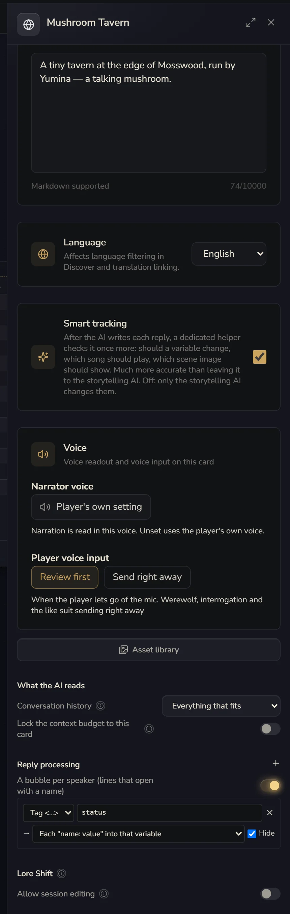

# Visuals & Audio

On the canvas, audio and scene images each get their own block. If you don't have them yet, click **＋ Audio** or **＋ Scene images** in the "Add" row at the bottom of the card. The screen players see is edited under **Player interface** at the top. Uploaded files live in **Panels → Assets**.

## Character portraits

Give a character a face: on the canvas, right-click that character's lore entry and pick **Portrait…** (in simple mode, click the camera square next to the character's name). Choose a picture from **Assets** or upload one on the spot. In chat, that picture and the character's name appear above every line they speak. When several characters have portraits, the AI is asked to start every reply with a hidden `[speaker: Name]` tag, so the right face is already on screen before the first word arrives. Replies tagged as narration show no face. If a model forgets the tag, the chat falls back to a "Name:" at the start of a line, or a name in the first sentence.

## Pictures in the opening

Openings can hold pictures. Click **Insert image or video** in the top right of the opening's text box, then upload one or pick one from **Assets**. You can also drag a file onto the text box, or just paste an image. The picture goes in at the cursor as `[image:@asset:…|alt=…]` and shows up in that spot in chat. After the `|` you can add: `alt=` (what the picture is), `caption=` (a line under it), `size=sm|md|lg|full`, `placement=left|center|right`. Plain markdown works too, like ``, and both styles accept an `https://` link instead of an asset.

## Player interface

The default chat interface is enough for most cards. If you want opening pages, a status panel, an inventory or a map, build them from templates in **Player interface** at the top, no code needed. See [Player interface](/creator/player-view).

If you want an interface that's entirely your own, like a green CRT-screen terminal for the end of the world, just describe the look to the Creation assistant: "post-apocalyptic horror UI, CRT monitor aesthetic, dim green glowing text, scanline effects". What it writes is interface code, which you can see in **Panels → Interface code**. The interface only displays things. It reads the game state, but it won't go changing it on its own.

The full interface code guide → [Custom UI guide](/creator/advanced/custom-ui-deep)

## Audio

| Type | Purpose | Example |
|------|------|------|
| **BGM** | Background music, loops continuously | Tavern theme, battle music, exploration track |
| **SFX** | One-shot sound effects | Sword clash, creaking door, notification chime |
| **Ambient** | Environmental loops, layered over the BGM | Rain, forest sounds, crowd murmur |


**BGM playlists** rotate through tracks automatically, and **Conditional BGM** switches based on game state (like playing battle music when the variable `location` is "arena").

Click a track in **Panels → Audio** to see its **Track ID**, with **Copy ID** right next to it. That's the ID to use in your own interface code, like `api.playAudio("track-id")`. Renaming the track doesn't change it, so your code keeps working.

Click a track on the canvas and write **When to play** in a sentence, like "a fight breaks out", and the AI switches to it when the story matches. Leave it empty and the track only follows playlists and conditional rules. Turn off **Allow AI control** and the AI cannot play, stop or change it at all, while your interface, behaviors and playlists still can.

Audio patterns and conditional BGM in detail → [Advanced: Audio Design](/creator/advanced/audio-deep)

## Voices and readout

Players can turn on **Voice readout** in their own settings to have the story read out. You can give each character a voice: on the canvas, right-click that character's lore entry, pick **Voice…**, choose one, and click **Preview voice** to hear it. Characters without a voice use the **Narrator voice**. If the narrator doesn't have one either, it uses whatever the player picked in their settings.

If nothing in the list fits, click **Design a voice with AI** under **Custom voices**. Describe the voice in a sentence, for example "a woman in her twenties, low and a little husky, speaks slowly", and click **Generate** to get 3 candidates. Play each one and click **Use** on the one you like: it becomes this character's voice and is added to your custom voices, so your other cards can use it too. The button shows how many mushies a generation costs; a failed one is refunded.

The narrator voice and **Player voice input** live in the **Sound** section of **Card settings** (click **Cover & blurb** on the right of the canvas, or **Panels → Card settings**). Player voice input decides what happens when the player holds the mic, speaks and lets go: **Review first** before sending, or **Send right away**. Cards built on quick reactions, like werewolf games or interrogations, suit Send right away.

Readout is off for new players, and the voice costs them mushies, so a card can't switch it on by itself. If your card talks out loud (a call, a companion), give it a **Turn on her voice** button: Yumina asks the player in its own dialog and switches readout on when they say yes. Ask the Studio assistant for a voice companion and it builds the sound check, the mic test, the model switch and the small window (picture-in-picture on phones) for you. How it works: [API reference](/creator/advanced/08-api-reference#recipe-a-voice-companion-card).



## Scene images

Pictures that show up on their own. Each scene image has a short id (`img1`), a picture from your asset library or an https URL, and a sentence or two saying **When to show it**, like "the cat Minyu gets startled and jumps straight up". That sentence is both the switch and the condition, and it's followed literally. Fill it in, and every reply that meets it carries the picture (write "after every reply" and it shows every turn). Leave it empty, and the picture only shows where you paste its code.

**Who places the images** is chosen at the top of the scene images page:

- **After each reply** (default, recommended): once the AI has written its reply each turn, smart tracking checks each picture's "When to show it" condition one by one, and puts every one that matches at the end of that reply. It works just as reliably whatever model the player uses.
- **Story AI inserts them**: the story-writing AI writes `[image: img1]` in its text, so a picture can sit between two paragraphs. But it depends on whether the model listens, and some models almost never do.

If you turn **Smart tracking** off in **Card settings**, only the story AI can insert them.

- Add them in the canvas's **Scene images** block (if there isn't one, click **＋ Scene images** at the bottom of the card). Upload from your computer or pick from your asset library. Drag several files in at once and you get several images, each named after its file.
- Write `[image: img1]` in an opening to show a picture right from the start. It works in lore entries too: when the AI uses that entry, it brings the picture into its reply.
- Under **Openings** you can limit a picture to certain openings.
- Players get a gallery in the play header. Pictures the story has already shown appear in full. The rest show your **Unlock hint**, so the player knows there's still a moment worth reaching.
- "When to show it" is followed exactly as written. Write "when the two of them sit across from each other in the café" and only those replies get the picture. Write "after every reply" and every reply gets it. A picture that was shown before comes back whenever its condition holds again.

## Assets

Upload images, audio, video, fonts and text files in **Panels → Assets**, or drop a whole folder onto the asset area and its folder tree comes with it. Files are hosted on Yumina's CDN and can be used anywhere: in the player interface, in lore, in openings and as audio tracks. Keep the tab open while a big upload runs, and **Retry remaining files** picks up anything that failed.

## AI image generation

You can also make pictures right on the platform. There are three ways in: the **AI Image Generation** card on the "Create" page, the **AI Generation** button in the top right of "My Library → Assets", and the **AI generation** section in the editor.

Write a line describing the picture, pick a model, an aspect ratio and how many images, then click "Generate". The default model costs about 35 mushies per image, charged by actual usage once the image arrives. If no image comes back, you aren't charged. Pictures usually take around 30 seconds, and a notification with a thumbnail tells you when they're done.

Generated pictures go into your asset library (you can pick a folder) and are used just like uploads, with `@asset:{id}`. You can also take an existing picture as a reference and describe how to change it.

Up to 2 pictures can generate at the same time, and you can submit up to 30 requests an hour. Pictures you post to the Plaza are checked, and anything showing minors or a real person's face is refused.

## Illustration LoRAs

Story illustrations can be drawn with a LoRA, so a character keeps the same face in every picture, or the whole card takes on one art style.

- **A character**: open the character's settings (right-click → settings, or double-click) and pick one under **Illustration LoRA**. It is used whenever that character is in the picture.
- **The art style**: **Card settings → Story illustrations → Art style LoRA**. Every illustration of the card uses it.
- **Yourself**: pick one for your persona under **Personas**. It is used when you are in the picture (walking beside a character, say).

In the picker, paste a Civitai link or upload a `.safetensors` file; once it's ready you can pick it. Illustrations take **Anima** LoRAs only; a LoRA for another model is refused with a message saying so. On Civitai, its author must allow use on generation services (Rent).

**Strength** defaults to 0.9 for a character and 0.8 for a style. The **trigger** defaults to the LoRA's first trained word; you can change it.

Good to know:
- A character LoRA brings its original outfit along. When the card's clothes matter more, lower the strength to 0.6–0.8.
- When two people with LoRAs share a picture, the two LoRAs mix into each other.
- Changing the art style LoRA or a character's LoRA sends a published card back to review.

## Live characters

A live character is a character made from one picture that breathes, blinks, follows the pointer, talks and shows expressions. Make one under **AI generation → Live character**.

**Put it in a card (no code).** Open the character on the canvas and pick her under **Live character**, or on the generation page use **Put in my card** and choose the character. The chat then shows her beside the conversation (a column on a computer, a strip above the chat on a phone), and her face follows each reply: the AI names a face at the start of every reply and the player never sees it. The faces it can pick are the ids in the table below and your own expressions, by the names you gave them. Only a card with a live character asks for this, about 100 tokens per reply.

**In an interface of your own.** A card with interface code shows her with `<RigCharacter pack="@rig:…" />`. Always use `@rig:`: it follows what you adjust or redraw later. The Studio assistant can do either.

**Picture.** One character, facing forward, upper body. Use a plain background in a colour that stands apart from the hair: light or wispy hair on a light background leaves a pale fringe. Keep the arms in view (not behind her or in pockets) so she can wave and gesture.

**Names.** `cue` and `hold` take the same names: the id, the label shown on the generation page (in any language, any case), or the name you gave one of your own expressions.

| Id | Label |
|---|---|
| `happy` | Happy |
| `laugh` | Laugh |
| `heart` | Smitten |
| `wink` | Wink |
| `shy` | Shy |
| `doubt` | Doubtful |
| `sigh` | Sigh |
| `surprised` | Surprised |
| `angry` | Angry |
| `sad` | Sad |
| `nod` | Nod |
| `shake` | Shake head |
| `tilt` | Tilt head |
| `lookdown` | Look down |
| `wave` | Wave |
| `welcome` | Arms open |
| `clasp` | Hands together |
| `chest` | Hand on chest |
| `shrug` | Shrug |

`laugh`, `heart`, `angry`, `sad` and `surprised` use drawings made for the character. A move switched off in **Adjust** plays a gentler one instead; your own expressions switched off play nothing.

**How long and how strong.** A plain `cue` lasts 1.3 to 3.6 seconds. Give it `seconds` to keep a face for a whole reply (it rests at its strongest moment; a nod or a shake repeats), and `strength` from 0 to 1.5. `hold(name, level)` keeps any face at that level until you set it back to `null`. Faces usually look best below full strength. `"heart"`, `"blush"`, `"eyes"` (the lids, 1 is open) and `"mouth"` are levels you can hold too. She never blinks while a face lowers or closes her lids; `blink(false)` stops the blinks altogether.

```tsx
// a face for the whole reply, at 70%
ctl.current.cue("angry", { seconds: 6, strength: 0.7 });
// hold one until you let go
ctl.current.hold("Doubtful", 0.6);
ctl.current.hold("Doubtful", null);
// no automatic blinks
ctl.current.blink(false);
```

**Adjust.** On the character's card on the generation page, **Adjust** sets how far she moves, how often she blinks, **Expression strength** for every face, which moves are on (your own expressions too), and lets you draw expressions of your own.

**An example to copy.** The [AI Companion Template](https://yumina.io/app/hub/bundles/7a152622-8c2c-4bbc-a2d3-6a9019546119) is a whole card built around a live character: her face follows each reply, she talks with a voice and reacts when touched. Start a card from it and swap in your own character.
