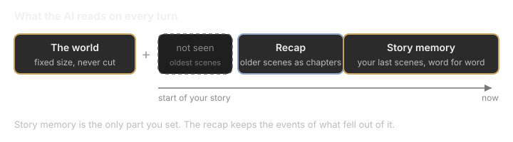
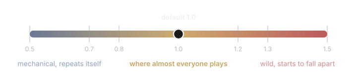
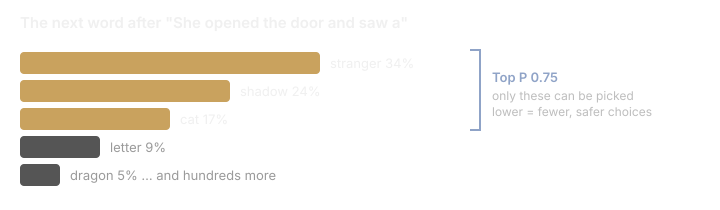

# Choosing an AI model

The model pill in the chat box changes the AI for your next reply, and Settings > AI Config sets your defaults for every chat. Better models cost more mushies per reply, and the picker shows the current price of each.

## Picking a model

Models come in four tiers: Budget, Standard, Premium and Ultra. Yumina Free costs nothing, Premium needs the Gold plan, and Ultra needs Platinum. New accounts start on Claude Sonnet as a taster and move to a mix of models when it runs out. Budget and Standard models are fine for casual play. If characters drift out of voice or the story loses its thread, moving up a tier fixes it more often than any setting. Pin up to eight models to keep them at the top of the picker, or choose Mix Models to let each reply draw a random model with the odds you set.

If a model fails to reply, the notice offers a retry, a backup model, or cancelling the turn. Backup model in AI Config can make that automatic. Other AIs on the same page picks the models for video, voice and the judge that checks the game's numbers, and the defaults are fine.

## Story memory

Every turn, the AI re-reads the world the creator wrote plus your conversation so far. The world is a fixed size and never gets cut. The conversation grows, which is why each reply costs a little more the longer you play.

Story memory is the amount of your conversation the AI reads word for word, and 16,000 is the suggested setting. Setting it much higher does not help. A very long history distracts the model from the world and from your latest message, especially on smaller models. Overall limit caps the whole request, world included, and Maximum available is right for almost everyone.

The recap folds older scenes into short chapters, so the AI keeps the events after it loses the exact words. It is on by default at Standard, and you can set it to Lean or Detailed, or turn it off. Recap model picks who writes it.

Memory in the chat's + menu shows which messages the AI reads word for word, which are in the recap, and which it no longer sees. Pinned notes are things you want the AI to keep no matter what, like a secret or an old wound. Select the sentences in any message and choose Remember this. Auto notes, an extension, lets the AI keep its own key facts as well.

Background work like the recap asks you once before it ever costs mushies, with the choice to allow it, use the free model, or not run it. Change your answer under Background AI charges in AI Config.

On the Free plan the world side is capped at 64,000 tokens, on Gold at 96,000, and from Platinum up it is never trimmed. With your own key there is no cap on any plan.

## Creativity, also called temperature

Creativity is how far the model strays from the most expected next word. Low, and it writes the safe, predictable sentence every time. High, and it takes chances, which reads as inventive until it stops making sense. The default is 1.0, and 0.8 to 1.2 covers almost everything. Claude models stop at 1.0. It sits under Generation Config in AI Config.

## Length, thinking and the advanced dials

Response Length is a ceiling on one reply, 12,000 tokens by default. Reasoning Effort, on models that have it, is how long the model thinks before it writes. Low is right for play, and High helps if the model keeps breaking the rules of the world. The model pill in a chat sets thinking for that chat alone.

Under Advanced Parameters, Top P is how many of the likely next words the model may choose from. At 1 it may pick any of them, and lowering it cuts off the long tail of odd choices. Frequency and Presence Penalty push the model away from repeating words and ideas, and 0.3 is enough if it keeps circling. Top K and Min P do the same job as Top P in a blunter way, and most people leave them off. Change creativity first, and change one thing at a time.

## Bring your own key

Switch Settings > AI Config to Private Key and paste a key from OpenRouter, Anthropic, OpenAI, Google, or any OpenAI-compatible service such as DeepSeek, Mistral or Groq. You pay the provider directly, no mushies are spent, you get every model they offer, and memory has no cap. Your key is stored encrypted and never shown again after you save it.

## Run it on your own computer

Yumina also plays on a model running on your own machine through Ollama, LM Studio, Jan or llama.cpp. Nothing is sent to our servers to write the story, and no mushies are spent. Keep the Yumina tab open while you play. If LM Studio refuses the connection, turn on Enable CORS in its server settings.

## Your own prompts

Prompts in Settings holds instructions you add to every chat. Where sets the spot: Start, next to the world's rules; In chat, a set number of messages back; or Last, right before the AI replies, which has the most effect. Send as decides whether the model reads it as a rule or as something the player said. Use them when the AI keeps making the same mistake, like answering in the wrong language. Prompts you switch on inside a chat, under Prompts in the + menu, apply to that world only.

## Related

- [Does Yumina remember my story?](../help/does-yumina-remember-my-story.md)
- [Which AI models can I use?](../help/which-ai-models-can-i-use.md)
- [Privacy](privacy.md)
